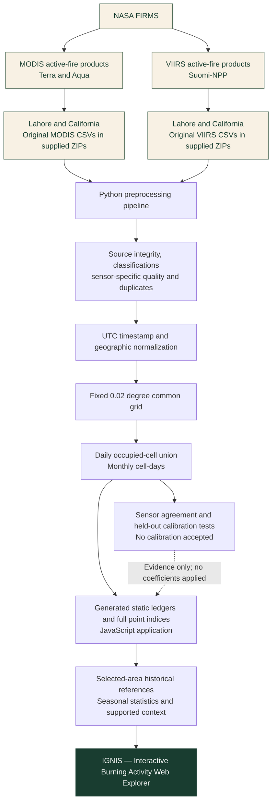

# IGNIS — Historical Burning Activity Explorer

**Live website: [https://ignis-fire-atlas.netlify.app/](https://ignis-fire-atlas.netlify.app/)**

A historical burning-activity explorer for **NASA Space Apps Challenge 2026 — Harmonization of MODIS and VIIRS Hot Spots**. MODIS and VIIRS have different sensitivities and observation schedules. IGNIS makes their supplied records explorable on a common grid, while keeping sensor differences visible in its scientific evidence.

The application is a static research demonstrator. It provides **sensor-aware integration**, not a validated sensor-independent fire estimate. Cell-days are neither individual wildfire counts nor burned area. [Challenge assessment](docs/CHALLENGE_ALIGNMENT.md) · [Scientific methods](docs/SCIENCE.md) · [Validation and limitations](docs/REVIEW.md)

## NASA Space Apps challenge

IGNIS addresses [Harmonization of MODIS and VIIRS Hot Spots](https://www.spaceappschallenge.org/2026/challenges/modis-and-viirs-hot-spots/). The challenge is to connect the long MODIS hotspot record with the continuity and finer detail of VIIRS, helping users understand where and when burning has been recorded from the early 2000s to the present.

The challenge has two main objectives:

1. **Harmonize MODIS and VIIRS observations** into a consistent activity record, so differences in sensor resolution, sensitivity and observation schedules do not distort historical patterns, trends or unusual periods.
2. **Build a web-based burning-activity calendar** where users can select an area and date range, explore historical activity, and download analytics and visualizations.

Suggested features include drawing an area on a map or entering coordinates, accessible colour ramps, comparisons with multi-year reference values, and downloadable hotspot CSVs. These support the main objectives; they are not all mandatory features.

IGNIS provides the interactive calendar, geographic selection and downloads, with separate raw-detection and cell-day views. Its common-grid integration is implemented; fully sensor-independent comparability remains unvalidated. The implementation table below distinguishes completed features from that remaining scientific objective.

## Our solution

IGNIS joins the longer MODIS record to finer-resolution VIIRS observations on one fixed spatial grid. Users can inspect what was recorded, where and when, while retaining the separate sensor views needed to interpret the transition. The calendar is the main route into the map and comparisons:

- Choose Lahore or California, UTC dates, sensor and either occupied cell-days or raw detections.
- Inspect the month-by-year calendar and select a month or day to update the map, metrics, historical comparison and exports.
- Draw, edit or reset a rectangular area; expand coordinate entry for exact bounds.
- Compare matching dates with eligible earlier years, or select a retrospective reference.
- Examine descriptive seasonal totals and supported recorded-activity labels. Unknown periods stay unknown; labels are not forecasts or emergency warnings.
- Download daily/monthly analytics, selected hotspot records for up to 31 inclusive days, or a calendar SVG.

The cream, forest-green and terracotta explorer contains three metrics in matching units. Detailed overlap calculations, calibration failures, source ledgers and the internal alignment score live in this repository. The map shows at most 650 sampled markers; calculations and selected-record exports use the full observations.

**First use of Draw Area:** The first area selection may take longer while your browser downloads the full observation indices for the selected region and years, then calculates the results. Please wait for the calculation message to clear. The browser keeps those indices in memory, so subsequent area edits usually respond faster. A shorter date range reduces the initial workload. Reloading the page or selecting uncached years/another region may require loading again; no server-side processing pipeline is started by drawing.

## Study areas

**Lahore is a city; California is a state.** The files describe rectangular study envelopes, not official administrative polygons or guaranteed complete satellite footprints. These are the minimum/maximum supplied point centers, not recovered original request boundaries:

| Study label | West | South | East | North |
|---|---:|---:|---:|---:|
| Lahore, Pakistan | 74.02003° | 31.25001° | 74.65° | 31.75° |
| California, USA | −124.39342° | 32.5° | −114.1° | 42.1° |

The project uses these two regions because those are the authentic datasets supplied for IGNIS. Their small urban-region and much larger state-scale envelopes provide contrasting activity and sampling conditions for testing. This is an analytical rationale, not a claim that they represent all fire regimes or that source selection followed a documented sampling design. Their different areas make direct total-to-total comparisons inappropriate.

## NASA objectives versus implementation

IMPLEMENTED means the stated software behavior was exercised; PARTIALLY IMPLEMENTED means useful functionality exists with material scientific limits; NEEDS FURTHER VALIDATION means the required scientific outcome has not been established. A working chart cannot validate sensor independence.

| NASA objective | Our implementation | Evidence | Status |
|---|---|---|---|
| NASA hotspot data integration | All four supplied FIRMS exports; source hashes, quality rules and classification retained | [Data audit](docs/DATA_AUDIT.md), [source validation](pipeline/validate_data.py) | IMPLEMENTED |
| Temporal/geographic alignment | UTC dates, shared 0.02° grid, exact point-center AOIs; matched timing diagnostics, unknown observation opportunities | [Methods](docs/SCIENCE.md), [timing tests](tests/test_transfer_validation.py) | PARTIALLY IMPLEMENTED |
| Cross-sensor harmonization | Sensor-aware occupancy union; tested calibration candidates rejected | [Held-out transfer evidence](docs/TRANSFER_VALIDATION.md) | NEEDS FURTHER VALIDATION |
| Historical calendar | Month/year heatmap and daily drilldown with explicit units and unknown states | [Calendar logic](site/app.js), [browser journey](tests/browser_journey.py) | IMPLEMENTED |
| Geographic selection | Draw/edit/reset and exact coordinates within either supplied study envelope | [Unsampled area engine](site/area.js), [independent AOI tests](tests/test_area.py) | IMPLEMENTED |
| Date selection | Inclusive UTC range; month/day selection coordinates map, metrics and CSVs | [Shared model](site/model.js), [regression tests](tests/model.test.mjs) | IMPLEMENTED |
| Seasonal comparisons | Descriptive totals with actual calendar support; no equal-exposure inference | [Denominator method](docs/SCIENCE.md#seasonal-comparison-denominators), [tests](tests/reference.test.mjs) | PARTIALLY IMPLEMENTED |
| Unusual-activity identification | Conditional percentile/MAD labels where supported; no formal anomaly significance | [Independent source example](tests/test_day_reference.py), [reference tests](tests/reference.test.mjs) | PARTIALLY IMPLEMENTED |
| Historical reference comparison | Same dates/era/AOI; earlier-years or retrospective references, explicit per-year exclusions | [October source audit](tests/test_october_reference.py), [review](docs/REVIEW.md#october-reference-correction) | PARTIALLY IMPLEMENTED |
| Exports and usability | Selected-record/aggregate CSV and calendar SVG; desktop/mobile local journeys | [Export code](site/exports.js), [browser tests](tests/browser_journey.py) | IMPLEMENTED |

The separate [weighted internal rubric](docs/CHALLENGE_ALIGNMENT.md) scores **60%**: scientific outcomes 35/75 and tested software scope 25/25. It assigns PASS = 1, PARTIAL = 0.5 and NOT VALIDATED = 0 to predeclared weights totaling 100, with 30 reserved for sensor-independent comparability. This is an internal project assessment, **not an official NASA score or certification**.

## Methodology — from NASA records to the explorer



The offline Python pipeline turns the supplied NASA records into checked ledgers and unsampled point indices, with a separate held-out scientific audit. Browser JavaScript filters those static observations, recomputes area occupancy and historical statistics, and renders the calendar, map and downloads. The audit contributes evidence, **not fitted coefficients**. PyCharm is an optional development environment; no PyCharm execution is claimed.

## NASA resources and data provenance

[NASA FIRMS](https://firms.modaps.eosdis.nasa.gov/) supplies the four existing download ZIPs and their eight CSV members. MODIS represents **Terra and Aqua**, Collection 6.1 family (`M-C61`): standard archive MCD14ML and NRT MCD14DL. Original versions are preserved as `6.03`, `61.03` and `6.1NRT`. The `SV-C2` files represent **Suomi-NPP VIIRS 375 m Collection 2**, standard VNP14IMGTML and NRT VNP14IMGTDL, with versions `2` and `2.0NRT`. NOAA-20/21 observations are not present or claimed.

Lahore MODIS dates run from 14 November 2000 to 13 November 2026; California MODIS starts 1 November 2000. Both VIIRS records run from 20 January 2012 to 2 November 2026. Standard/NRT endpoints vary by member; inspect the [data audit](docs/DATA_AUDIT.md) and [source manifest](config/source_manifest.csv). Request IDs and filenames establish FIRMS export provenance, but original order receipts, exact request dates/extents and acquisition completeness are unavailable. This application does not call a live NASA fire API.

The Python build streams the existing ZIP members without editing them. It validates coordinates, UTC timestamps, platforms and confidence domains, normalizes thermal-column aliases and preserves source versions and inferred classifications. MODIS ≥30 and VIIRS nominal/high are separate quality policies. Unknown types remain unknown; type 0 means presumed vegetation, not a confirmed wildfire incident. Exact duplicate identity uses measurement fields, with standard-product precedence over matching NRT copies. All **1,515,265 source rows** reconcile; **1,435,985** pass the grid quality policy. No exact duplicates or invalid observations were found in these supplied files.

Reported point centers enter a fixed **0.02° grid anchored at (−180°, −90°)**. For each UTC day, a cell recorded by either sensor contributes once to Integrated occupancy; summing days gives cell-days. An inclusive custom rectangle filters point centers before occupancy is recomputed. The grid is not equal-area and does not correct detection probability, clouds or overpass differences. Raw detections retain individual supplied rows.

The build publishes daily ledgers, unsampled compact point indices and separately sampled map partitions. Browser JavaScript queries all selected observations in a worker, computes the calendar and reference statistics, and renders a local Leaflet map. No runtime backend, database, API key or new observation dataset is required. Original files remain read-only; SHA-256 hashes and row-level projection checks verify integrity.

NASA product definitions and attribution: [MODIS attributes](https://firms.modaps.eosdis.nasa.gov/content/descriptions/FIRMS_MODIS_Firehotspots.html), [VIIRS attributes](https://firms.modaps.eosdis.nasa.gov/content/descriptions/FIRMS_VIIRS_Firehotspots.html), [FIRMS readme and disclaimer](https://firms.modaps.eosdis.nasa.gov/download/Readme.txt). Existing contextual geography uses public-domain [Natural Earth](https://www.naturalearthdata.com/about/terms-of-use/), with optional [OpenStreetMap](https://www.openstreetmap.org/copyright) tiles. Neither supplies scientific observations. Bundled Leaflet uses its [BSD license](site/vendor/LEAFLET-LICENSE.txt).

**SI-assisted processing:** OpenAI ChatGPT and Codex assisted with code development, debugging, testing, scientific-method review, interface refinement and documentation. The NASA observations were not AI-generated or replaced. Derived results are calculated from authentic observations using reproducible code. The companion [processing metadata](site/data/processing_metadata.json) records this assistance in machine-readable form alongside the processed data.

## Mathematics and scientific limits

For area A on UTC day t, let M(t,A) and V(t,A) contain occupied MODIS and VIIRS cells. **U(t,A) = |M(t,A) ∪ V(t,A)|**; monthly **D(m,A) = Σ U(t,A)** in cell-days. Sensor overlap is counted once each day. Daily **Jaccard = |M ∩ V| / |M ∪ V|** is undefined for an empty union. Acquisition-time matching is a separate token diagnostic. Neither agreement measure identifies physical fire events.

Historical references match calendar dates, sensor configuration, geographic area and selected classification. The target is excluded; earlier-years mode also excludes later observations. At least five eligible years support a descriptive median/range, and eight plus nonzero MAD support **(value − median)/(1.4826 × MAD)**. Tied percentiles use **100 × (below + 0.5 × equal)/N**. Positive daily archive support is a selection condition, **not complete observation coverage**. Seasonal bars show descriptive totals and unequal calendar support; no detection-positive denominator is used to imply comparable exposure. [Full equations, selection bias and safeguards](docs/SCIENCE.md)

Lahore is sparse, and seasonal/geographic calibration transfer remains unreliable. **No calibration passed acceptance or enters the application.** Numerical errors, sample sizes, bias and uncertainty belong in the [transfer validation report](docs/TRANSFER_VALIDATION.md); the observable calendar retains its original units and values.

Missing records remain unknown; retained zeros following raw detections only describe quality filtering. October 2026 can display many recorded years while lacking a comparable target because it uses NRT products. Eligible historical counts and precise target exclusions are now distinct. Formal observation-adjusted anomalies, sensor independence and fire forecasts remain unsupported. [October case audit and acceptance report](docs/REVIEW.md)

## Satellite Detection Limitations

**NASA-documented limitations:**

- **Undetected fires:** Clouds, heavy smoke or canopy can hide fires; short-lived fires can occur between overpasses, and small or cool fires may fall below detection thresholds. Viewing geometry also changes the ground area sampled. [FIRMS detection notes](https://firms.modaps.eosdis.nasa.gov/alerts/notes.php), [MODIS pixel geometry](https://firms.modaps.eosdis.nasa.gov/content/descriptions/FIRMS_MODIS_Firehotspots.html).
- **Sensor differences:** MODIS has nominal 1 km pixels; VIIRS uses 375 m fire-detection pixels, responds more strongly to small fires and has different observation characteristics. IGNIS's shared grid aligns locations; it does not make the measurements physically equivalent. [FIRMS VIIRS description](https://firms.modaps.eosdis.nasa.gov/content/descriptions/FIRMS_VIIRS_Firehotspots.html).
- **Missing records:** No detected hotspot does **not** establish that no fire occurred. NASA documents periods when cloud and smoke concealed active burning. [FIRMS cloud-obscuration example](https://wiki.earthdata.nasa.gov/spaces/FIRMS/blog/2024/08/07/382276882/The+Impact+of+Cloud+on+Active+Fire+Detections).
- **Hotspots versus wildfires:** Thermal anomalies can include volcanoes, gas flares and other heat sources. A detection is not necessarily a confirmed wildfire or an entirely burning pixel. Hotspot counts—and IGNIS cell-days—do not measure burned area. [FIRMS map interpretation](https://firms.modaps.eosdis.nasa.gov/map/index.html).

**Calibration uncertainty — IGNIS-specific finding:** Reliable observation-coverage information and independent validation are missing. Our held-out experiments do not support complete sensor-independent calibration, so no fitted coefficient is applied. This is our experimental conclusion, not a NASA certification or a universal claim that calibration is impossible. Detailed calculations and missing-evidence requirements remain in [scientific methods](docs/SCIENCE.md#identifiable-quantities-and-missing-evidence) and [transfer validation](docs/TRANSFER_VALIDATION.md).

## Application, local launch and PyCharm

The generated static site is already included. In PowerShell:

```powershell
Set-Location E:\IGNIS
.\.venv\Scripts\python.exe -m http.server 8000 --bind 127.0.0.1 --directory site
```

Open [localhost:8000](http://127.0.0.1:8000/); stop with Ctrl+C. In PyCharm open the project root and select `.venv\Scripts\python.exe`. A Python module run configuration can use `http.server` with parameters `8000 --bind 127.0.0.1 --directory site`. Use HTTP rather than opening index.html directly, because the site fetches its local data files.

For a fresh environment, install Python 3.13, create `.venv` with `py -3.13 -m venv .venv`, and install `requirements.txt`. Node 24 is used for standalone JavaScript tests; optional Playwright with an installed Edge browser runs the UI journey.

## Reproduce and test

Keep the four original ZIPs in `data/raw/` under the exact names in [regions.json](config/regions.json). The original CSVs must not be edited. Rebuilding is optional when using the already-generated site:

```powershell
.\.venv\Scripts\python.exe -m pip install -r requirements.txt
.\.venv\Scripts\python.exe -m pipeline.build_data
.\.venv\Scripts\python.exe -m pipeline.validate_data
.\.venv\Scripts\python.exe -m pipeline.transfer_validation
.\.venv\Scripts\python.exe -m pytest -q
node --test tests/model.test.mjs tests/reference.test.mjs
.\.venv\Scripts\python.exe -m pip install playwright
.\.venv\Scripts\python.exe tests/browser_journey.py
.\.venv\Scripts\python.exe tests/check_readme.py --render-mermaid
```

The transfer command writes derived diagnostic evidence only; it never installs a calibration in the calendar. Browser tests launch an isolated loopback server and check real downloads, filters, AOIs, keyboard controls and mobile layout. Screenshots go to ignored `data/work/`. The README check verifies local evidence links and renders its Mermaid diagram locally using a pinned rendering library (downloaded on first use); omit `--render-mermaid` for the offline link/structure check. It does not publish anything. [Data contracts](docs/SCHEMA.md) explain static indices and exported fields.

## Short demonstration

1. Start in Lahore: Integrated 19,724 cell-days, MODIS 5,728 and VIIRS 14,846. Sensor totals overlap. Switch to raw detections to see the distinct source-row metric.
2. Choose California and September 2020: 17,272 Integrated cell-days. Select a day, inspect a mapped observation and export the selection.
3. Draw an area inside the dashed envelope, edit it, enter exact coordinates, then reset. Date and sensor settings persist.
4. Return to Lahore, inspect 5 November 2021: 57 cell-days. Earlier-years reference has six eligible years and median 22, insufficient for an unusualness label. Selecting retrospective references gives eight years, median 22, middle 50% 11–25.5 and a scaled robust deviation of 2.951 (exact score in CSV). The label describes recorded history, not emergency risk.
5. Switch to VIIRS before 2012 to see unavailable periods. Empty in-range dates remain unknown rather than confirmed no-fire dates.

## Scientific evidence and deployment

Read [methods](docs/SCIENCE.md), [original matched-date experiments](docs/MATCHED_AGREEMENT.md), [extended transfer validation](docs/TRANSFER_VALIDATION.md), [acceptance results](docs/REVIEW.md) and the [internal challenge rubric](docs/CHALLENGE_ALIGNMENT.md). All attempted coefficients remain unapplied. Complete satellite-observation coverage, physical sensor independence and formal anomaly significance are not established.

The [live IGNIS explorer](https://ignis-fire-atlas.netlify.app/) is hosted on Netlify. The static deployment serves `site/` with no build command, as configured in [netlify.toml](netlify.toml). The recorded browser regression results describe local tests; a complete production interaction test is not claimed here. Raw ZIPs, intermediates, screenshots, virtual environments and IDE state remain excluded from Git. Review changes before committing and preserve the existing Git history.

## Super Intelligence (SI) Usage Disclosure

Team AIOUS used **OpenAI ChatGPT, GPT-6 Astra, and OpenAI Codex** to assist with the development of IGNIS.

### How SI Tools Were Used

- **Coding and Debugging:** Assisted with Python and JavaScript development, debugging, optimization, and testing.
- **Data Analysis:** Assisted with statistical calculations, sensor harmonization experiments, calibration evaluation, and validation.
- **Documentation:** Assisted with technical explanations, scientific reports, and README preparation.
- **Presentation:** Assisted with presentation content, slide design, and explanatory illustrations.

### Data Authenticity and Scientific Integrity

- All satellite observations originate from **authentic NASA FIRMS MODIS and VIIRS datasets**.
- No satellite observations were AI-generated, fabricated, or replaced.
- Scientific calculations were evaluated using reproducible tests and documented validation procedures.
- Calibration coefficients that failed validation were not applied.
- AI-generated illustrations, where included, are identified as AI-generated.

### Human Oversight

**Team AIOUS** directed the project's objectives, selected the study regions, reviewed scientific results, and made final implementation and presentation decisions.

SI tools were used as development assistants, not as replacements for authentic NASA data or scientific validation.
